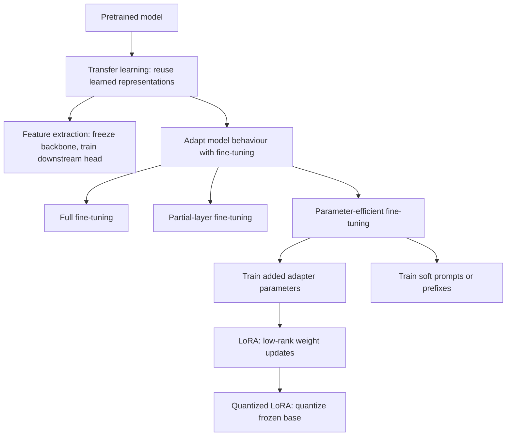

# LoRA and QLoRA

A learning guide connecting transfer learning, fine-tuning methods, low-rank updates, and quantization to this repository's completed experiment. Start with the concept map, then follow the equations and implementation links.

## 1. Concept map

**Transfer learning is the umbrella concept:** reuse what a pretrained model learned for a new task. Two common routes are frozen feature extraction and fine-tuning. Fine-tuning can update existing weights or learn additional parameters, such as LoRA adapters. Section 2 separates four practical categories before Sections 3 and 4 explain LoRA and QLoRA.



This is a practical teaching structure, not an exhaustive taxonomy. Terminology overlaps: training a new head can itself be described as parameter-efficient adaptation. Quantization is a separate representation choice that can be combined with an adaptation method. Supervised fine-tuning describes the **training objective/data**, while LoRA describes **which parameters are trained**.

| Concept | Question it answers | Example |
|---|---|---|
| Transfer learning | Can existing representations help a new task? | Reuse a pretrained text model |
| Feature extraction | Can a frozen representation support a downstream predictor? | Train a classifier on frozen embeddings |
| Fine-tuning | How do we adapt a pretrained model through training? | Supervise passage-grounded answers |
| PEFT | Can we adapt with relatively few trainable parameters? | Train adapters or soft prompts |
| LoRA | How can weight updates be parameterised compactly? | Train two low-rank matrices |
| Quantized LoRA | How can frozen base storage be reduced too? | Train adapters over 4-bit base weights |

Prompting and RAG are additional ways to change application behaviour without necessarily updating model parameters. A supplied passage is context, not automatically a RAG system: this lab evaluates generation with provided context and does not run retrieval.

### 1.1. Transfer learning: feature extraction or fine-tuning

Transfer learning reuses capabilities learned from prior data. Training from scratch starts with untrained parameters; adaptation starts with a pretrained model.

In frozen feature extraction, the backbone maps an input into features and a separate head learns a task. For example, compute fixed text embeddings, then train a linear classifier. This can be inexpensive and useful when representations already separate the target classes, but the backbone cannot adjust to the new task.

Fine-tuning permits some part of the model or added parameters to learn from task examples. More flexibility does not guarantee better results: limited or skewed training data can make an adapted model worse than its baseline.

## 2. Fine-tuning categories

Once fine-tuning is chosen as the transfer-learning route, the next question is **which parameters should change?** The four categories below organise that choice. Full and partial fine-tuning update existing weights; the other two are common parameter-efficient approaches. They are useful categories rather than a complete, mutually exclusive classification of every method.

| Category | What gets trained? | Main tradeoff |
|---|---|---|
| Full fine-tuning | All base-model parameters | Flexible, but expensive in gradients, optimizer state, and model copies |
| Partial-layer fine-tuning | Selected existing layers; others frozen | Less training state, but adaptation constrained to chosen layers |
| Adapter-based tuning | Added trainable modules or updates; base usually frozen | Small task-specific weights; placement/capacity matter |
| Soft-prompt/prefix tuning | Learned continuous prompts or prefix representations | Few trainable parameters; differs from weight-update adapters |

LoRA is an adapter-based, low-rank update method, not the same architecture as every bottleneck adapter. Selecting only four transformer blocks **for LoRA insertion** also differs from unfreezing the original weights of four blocks. This lab does the former.

Soft prompts are learned vectors, not manually written instructions. See [Hugging Face's prompt-method explanation](https://huggingface.co/docs/peft/conceptual_guides/prompting).

## 3. LoRA: the low-rank update

For a linear layer with column-vector input, let the frozen weight matrix be $W_0 \in \mathbb{R}^{d_{out}\times d_{in}}$. Represent the update as:

$$
W' = W_0 + sBA,\qquad
A \in \mathbb{R}^{r\times d_{in}},\quad
B \in \mathbb{R}^{d_{out}\times r}.
$$

The output is $y=W_0x+sB(Ax)$. Only $A$ and $B$ are trained. The rank of $BA$ is at most $r$; this constrains the **update**, not the rank of the original pretrained weight matrix. It is not a process of recomputing an SVD at each training step.

The original [LoRA paper](https://arxiv.org/abs/2106.09685) introduces learning low-rank updates while freezing pretrained weights. The scale is often expressed as $s=\alpha/r$, but implementations may expose scaling differently; inspect the actual code rather than assuming a universal convention.

### Worked parameter-count example

Consider a hypothetical 4096-by-4096 linear matrix and rank 8:

- Updating the entire matrix would involve $4096^2=16,777,216$ trainable parameters.
- The two adapter matrices contain $8\times4096+4096\times8=65,536$ parameters.
- That is 256 times fewer trainable parameters for this one layer.

This is arithmetic for an illustrative layer, not this model's measured adapter count. The base matrix still exists. Memory reduction is therefore not automatically 256-fold: base weights, activations, and other buffers remain.

### How one training step works

1. Select the passage, question, and target answer.
2. Evaluate the frozen model with the current adapter updates.
3. Compute next-token cross-entropy on target-answer tokens; prompt tokens provide context but are masked from loss.
4. Backpropagate through the computation to obtain adapter gradients.
5. Update adapter parameters with the optimizer; keep base weights frozen.

Frozen weights do not mean every activation can be discarded: backpropagation still needs relevant intermediate computation. Gradient checkpointing trades recomputation for activation-memory savings.

Teacher forcing supplies preceding correct answer tokens during training. Held-out evaluation instead generates answers. Lower teacher-forced loss is not sufficient evidence of better generated behaviour.

## 4. LoRA vs QLoRA: representation, computation, and memory

Both freeze pretrained weights and train low-rank updates. QLoRA additionally reduces the representation cost of the frozen base. The comparisons below describe conventional LoRA and the original QLoRA approach; Section 5 identifies the MLX-specific implementation used in this lab.

### 4.1. At a glance

| Feature | Conventional LoRA | Original QLoRA approach |
|---|---|---|
| Frozen base weights | Usually FP16/BF16 | 4-bit NF4, with quantization metadata |
| Trainable parameters | Low-rank matrices | Low-rank matrices |
| Adapter arithmetic | Floating point, commonly FP16/BF16/FP32 | Floating point, not 4-bit adapter training |
| Memory | Higher frozen-weight allocation | Lower frozen-weight allocation; other training costs remain |
| Speed | Can avoid quantized-kernel overhead | Reconstruction/kernels may add overhead; benchmark rather than assume |
| Quality | Depends on data, task, and optimization | Can be comparable, but quantization and training may degrade it |
| Main motivation | Adapt with few trainable parameters | Fit adaptation into a smaller memory budget |

These are typical choices, not universal guarantees. LoRA itself does not mandate a particular base precision.

### 4.2. Two computation paths

For column-vector inputs and the conventional scale $s=\alpha/r$:

$$
\text{LoRA:}\quad y=W_0x+\frac{\alpha}{r}BAx
$$

$$
\text{QLoRA:}\quad y=\operatorname{Dequant}(W_{4bit})x+\frac{\alpha}{r}BAx
$$

`Dequant` represents reconstructing approximate floating-point values for computation. It does not mean storing a permanent full-size BF16 duplicate of the entire model; quantized kernels can reconstruct values in blocks as needed. Storage precision and compute precision are different decisions.

```text
LoRA                                  QLoRA
input                                 input
  |                                     |
  +--> frozen FP16/BF16 base path        +--> frozen 4-bit base path
  |                                     |    reconstruct for computation
  +--> trainable low-rank path           +--> trainable low-rank path
  |                                     |
add outputs                           add outputs
```

Gradients update the adapter matrices; the frozen pretrained weights or their quantized codes are not optimized. Backpropagation through the calculation still requires intermediate information. Adapters remain floating point, even though the base weights are stored in 4 bits.

### 4.3. Four components to understand in original QLoRA

The overall mechanism is **a frozen quantized base plus trainable LoRA adapters**. The original paper highlights three additional memory-efficiency techniques. Counting the mechanism gives the four components below; it would be misleading to call all four separate new quantization inventions.

| Component | What it does | What it does not imply |
|---|---|---|
| Frozen 4-bit base + LoRA | Stores the large base compactly while optimizing small adapter updates | Adapters or all computation use 4-bit precision |
| NF4 | Uses a nonuniform 4-bit codebook tailored to approximately normally distributed weights | Every weight tensor is perfectly normal or NF4 always preserves quality |
| Double quantization | Compresses quantization constants as well as weight codes | Quantizes the trainable adapters a second time |
| Paged optimizers | Use CUDA unified-memory paging to manage optimizer-state memory spikes | Eliminate optimizer state or guarantee faster training |

NF4 distinguishes weight storage from ordinary uniformly spaced INT4. Double quantization reduces metadata overhead. Paged optimizers address transient memory pressure. These mechanisms are described in the [original QLoRA paper](https://arxiv.org/abs/2305.14314); none should be inferred merely from the label “4-bit.”

CUDA unified-memory paging here is a software/hardware mechanism for moving managed allocations between host and GPU memory. It is not the same thing as the M1's physically shared CPU/GPU memory architecture.

### 4.4. Illustrative 7B weight-storage calculation

For exactly seven billion parameters, theoretical weight-code sizes are:

| Representation | Calculation | Decimal GB |
|---|---|---:|
| FP16/BF16 | $7\times10^9\times16/8$ bytes | 14.0 |
| 4-bit codes | $7\times10^9\times4/8$ bytes | 3.5 |

The idealized reduction is 75%, **for base weight codes only**. Actual allocation includes quantization metadata, tensors left at higher precision, adapters, gradients, optimizer state, activations, and temporary buffers. This is neither a measured 7B experiment nor a promise that training fits in 3.5 GB. Section 6 relates that accounting to this lab's measured peaks.

### 4.5. Practical library choices versus this lab

In a typical Hugging Face workflow, both methods use PEFT `LoraConfig`. A QLoRA-style loader additionally uses `BitsAndBytesConfig`; important independent options are:

| Option | Meaning |
|---|---|
| `load_in_4bit=True` | Quantize supported base layers |
| `bnb_4bit_quant_type="nf4"` | Select NF4 representation |
| `bnb_4bit_use_double_quant=True` | Compress quantization constants |
| `bnb_4bit_compute_dtype=torch.bfloat16` | Choose BF16 computation where supported |

A paged optimizer is configured separately, not enabled by `BitsAndBytesConfig` alone. This table is conceptual background, not an executable training recipe for this Mac. See the [official bitsandbytes integration documentation](https://huggingface.co/docs/transformers/quantization/bitsandbytes).

**This repository uses MLX quantized LoRA.** It trains floating-point adapters on an MLX 4-bit base, but does not reproduce the original NF4/double-quantization/paged-optimizer stack. The [MLX-LM training guide](https://github.com/ml-explore/mlx-lm/blob/main/mlx_lm/LORA.md) uses QLoRA for training LoRA on a quantized model. The recorded measurements apply to that implementation.

### 4.6. Choosing a method and deploying the result

| Constraint | Starting point |
|---|---|
| Base and training state fit comfortably; throughput matters | Try conventional LoRA, then benchmark |
| Frozen base weights dominate a limited memory budget | Try quantized LoRA |
| Quantization degrades the baseline materially | Investigate higher precision or another quantization/model configuration |
| Activations dominate because sequences are long | Examine sequence length, batch size, and checkpointing too |

QLoRA is principally a training-memory strategy; it does not automatically optimize inference. Deployment can keep adapters separate or merge their update into compatible weights. For a quantized base, merging may require reconstruction and requantization, potentially adding approximation error. Measure deployed quality again; training savings do not determine deployment quality.

## 5. What is implemented here?

| Setting | Regular LoRA | MLX quantized LoRA |
|---|---|---|
| Upstream model | Same pinned Qwen2.5-0.5B-Instruct | Same pinned Qwen2.5-0.5B-Instruct |
| Frozen base representation | BF16 | MLX 4-bit |
| Adapter rank / scale | 8 / 16 | 8 / 16 |
| Adapted transformer blocks | Four | Four |
| Trainable parameters | 733,184 | 733,184 |
| Batch / steps / sequence budget | 1 / 200 / 512 | 1 / 200 / 512 |
| Loss | Completion-only | Completion-only |

The lab supplies orchestration and evaluation; MLX-LM supplies adapter layers and training internals.

- [Model preparation](../src/finetuning_lab/benchmark.py): adds `-q --q-bits 4` for the quantized variant.
- [Training worker](../src/finetuning_lab/training_worker.py): loads the selected model and calls MLX-LM `train_model`, recording measurements.
- [Training configuration](../configs/m1.json): adapter and optimization settings.
- [Data and scoring](../src/finetuning_lab/core.py): passage prompts, targets, and held-out metrics.

In the tested MLX-LM 0.30.7 `LoRALinear`, inputs use a row-vector convention: `linear(x) + scale * ((dropout(x) @ lora_a) @ lora_b)`. `scale=16` is a direct multiplier; it is **not** an `alpha=16` setting automatically divided by rank. One adapter matrix starts randomly and the other at zero, so the initial added path contributes zero. Adapter arithmetic is floating point, not 4-bit weight-code training. Inspect the installed `mlx_lm/tuner/lora.py` and saved parameter shapes for exact implementation details.

## 6. Memory: why the savings are smaller during training

A useful accounting model is:

```text
training memory ≈ base weights + adapter weights + adapter gradients
                + optimizer state + activations + temporary buffers
```

LoRA reduces trainable state compared with full fine-tuning. Quantized LoRA additionally reduces frozen base storage. Activations and temporary buffers do not shrink in the same proportion, so a roughly fourfold base-weight storage reduction cannot be assumed to yield a fourfold training-peak reduction.

The lab resets MLX peak allocation after loading the base and preparing datasets, then measures adapter/optimizer setup, training, validation, and checkpoint saves. The measurement includes the base allocation. It excludes total system RAM and allocator cache; throughput counts completion-loss tokens rather than every prompt token.

## 7. Why evaluate four configurations?

| Configuration | Comparison purpose |
|---|---|
| Unquantized base, no adapter | Reference for regular LoRA |
| Unquantized base + adapter | Effect of regular LoRA adaptation |
| Quantized base, no adapter | Reference for quantized LoRA; compare with unquantized baseline |
| Quantized base + adapter | Effect of adaptation on the quantized base |

Comparing only the two final adapters would mix quantization effects with adaptation effects. Keeping a baseline for each representation makes the evidence easier to interpret.

The [recorded benchmark](../results/benchmark-2026-10-12.md) found peak training allocation of 1.710 GB versus 1.085 GB, a 36.54% reduction. Quantized-LoRA training took approximately 14% longer. The equal adapter count supports a matched-capacity comparison, while model source, tokenizer, data, and settings are also checked.

Quality did not improve: answer exact match fell from 53% to 12% for regular LoRA and from 24% to 9% for quantized LoRA. The adapters incorrectly refused 76 and 82 of the 100 answerable questions. High abstention recall alone therefore obscures a loss of useful answering behaviour. An always-refuse model scores 50% overall exact match on this balanced test set.

These results support a resource tradeoff on this workload, not universally superior quantized LoRA or successful adaptation. This is one model, seed, and training configuration. The cause of over-abstention is not established by aggregate metrics.

## 8. Common misconceptions

- **“LoRA freezes the whole computation.”** It freezes base parameters; adapter learning still uses forward and backward computation.
- **“QLoRA trains a 4-bit adapter.”** The quantized object here is the frozen base; adapter parameters are floating point.
- **“More rank or more steps must improve quality.”** More capacity or training can also amplify overfitting or undesired behaviour.
- **“The last checkpoint is best.”** Select checkpoints with validation data; keep test data for final assessment.
- **“Fine-tuning replaces retrieval.”** Behaviour adaptation and supplying external evidence solve different problems and can be combined.
- **“Lower loss proves better answers.”** Generated-answer quality must be evaluated separately.

## 9. Check your understanding

1. Which parameters change during this lab's training, and which stay frozen?
2. Why does reducing adapter parameters not remove base-weight memory?
3. What differs between adapting four blocks and unfreezing four blocks?
4. Why is this MLX experiment not a reproduction of original NF4 QLoRA?
5. What does each baseline isolate in the four-way evaluation?
6. How can abstention recall improve while the application becomes less useful?

For commands, reproducibility details, and complete limitations, return to the [README](../README.md).
